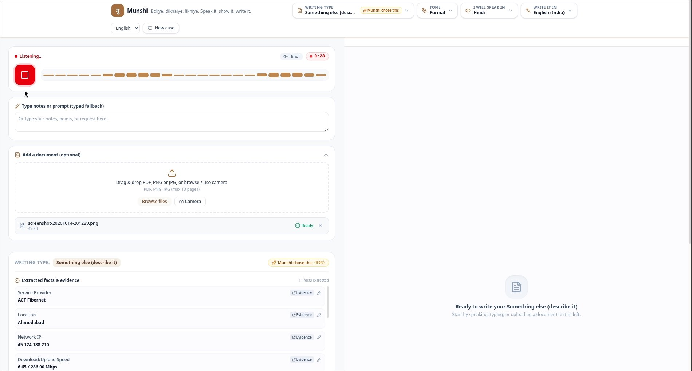
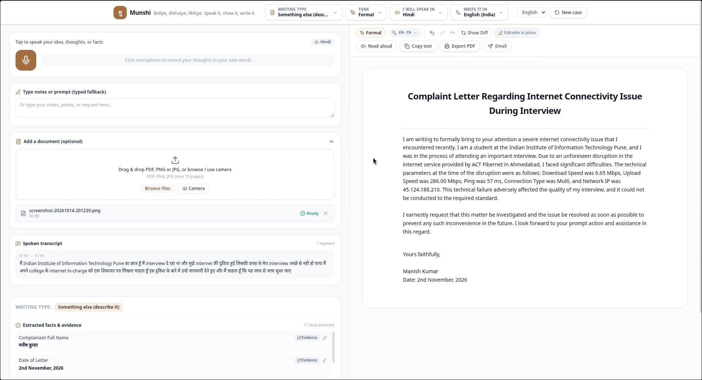
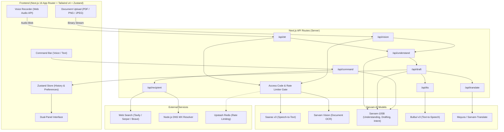

# Munshi (मुंशी)

<div align="center">

**The Sovereign Multilingual AI Writing Assistant & Document Scribe for Bharat & Beyond**

[](https://nextjs.org/)
[](https://react.dev/)
[](https://www.typescriptlang.org/)
[](https://tailwindcss.com/)
[](https://www.sarvam.ai/)
[](https://opensource.org/licenses/MIT)

*Boliye, dikhaiye, likhiye — Speak it, show it, write it.*

[Demo & Video](#-demo--screenshots) • [Key Features](#-key-features) • [Architecture](#-architecture--data-flow) • [Supported Categories & Types](#-supported-writing-types) • [Quickstart](#-getting-started) • [API Reference](#-api-reference) • [Deployment](#-deployment)

---

</div>

## Demo & Screenshots

### Full YouTube Walkthrough
Click the video below to watch **Munshi** transcribe Hindi speech, parse proof documents, and draft a formal complaint in English in real time:

[](https://youtu.be/PKKM2zqMgCw)

>  **Direct YouTube Link**: [https://youtu.be/PKKM2zqMgCw](https://youtu.be/PKKM2zqMgCw)

---

### Application Walkthrough

<div align="center">

#### 1. Live Multilingual Voice Dictation & Supporting Document Extraction
*Real-time audio waveform level visualizer, recording timer, and instant entity extraction from uploaded speed test screenshots & official receipts.*



<br/>

#### 2. Cross-Lingual Legal Drafting with In-Place Rich Text Editing
*Spontaneous Hindi dictation translated and structured into a formal English complaint letter with in-place click-to-edit fields, layout controls, and export options.*



</div>

---

## 📌 Overview

**Munshi** (मुंशी) bridges the linguistic, technical, and bureaucratic divide by transforming spontaneous spoken thoughts, rough typed notes, or photographed paperwork into publication-grade letters, consumer complaints, RTI filings, workplace emails, academic abstracts, and creative literature.

Built atop the **Sarvam AI** foundation model ecosystem, Munshi is designed from the ground up for linguistic sovereignty across India's regional languages. It strictly decouples **dictation language**, **document language**, **tone**, and **layout**, ensuring users can speak naturally in their mother tongue while producing formally compliant documents in any required language.

### Core Guarantees & Principles

- **Zero Hallucination in Official Filings (`strict` & `facts` grounding)**: For legal, dispute, and grievance documents, every assertion is traceable to the user's spoken input or OCR text. Foreign numbers, accounts, and assertions are flagged visibly.
- **Contact Integrity (Rule R1)**: Official recipient email addresses and phone numbers are **never invented by an LLM**. They are strictly extracted from uploaded documents or discovered via live web search ranking official domains (`.gov.in`, `.nic.in`, `.ac.in`) with DNS MX verification and SSRF-hardened network fetching.
- **Independent Language Choices**: Dictate in Bengali or Punjabi, generate in Hindi or English, and freely translate or rewrite without losing structural context.
- **Client Sovereignty**: Munshi prepares ready-to-send drafts that open securely in your local mail client (`mailto:`) or Gmail Web compose—your credentials and credentials never touch outbound mail servers.

---

## ✨ Key Features

### 1. Multilingual Audio Dictation & Transcription
- Powered by **Sarvam Saaras v3** with full auto-detection and support for 11+ Indic languages (Hindi, Bengali, Gujarati, Kannada, Malayalam, Marathi, Odia, Punjabi, Tamil, Telugu, and Indian English).
- Live recording timer, audio-chunking for extended recordings via Sarvam batch endpoints, and automated filtering of empty micro-clicks.

### 2. Vision & Document AI OCR
- Powered by **Sarvam Vision** with server-side magic-byte validation (`PDF`, `PNG`, `JPEG`) ensuring robust security against MIME spoofing.
- Multi-page document handling (up to 10 pages) with background job state polling and extraction of account numbers, billing periods, disputed sums, and reference numbers.

### 3. Interactive Understanding Engine
- Powered by **Sarvam-105B**: identifies user intent, suggests appropriate document types, extracts domain-specific entities, and generates intelligent follow-up questions tailored to the speaker's language.
- Non-intrusive: only asks for what is strictly missing according to the document schema, remaining silent for creative pieces.

### 4. Four Bespoke Document Layouts
- **Letter Layout**: Classical bureaucratic and legal hierarchy with sender, recipient, date, reference, subject line, body paragraphs, and mandatory legal disclaimers.
- **Email Layout**: Clean subject line, salutation, body paragraphs, and professional sign-off.
- **Prose Layout**: Formatted title, section headings, and academic or narrative prose.
- **Verse Layout**: Indented stanzas with rhythm preservation for poetry (Free verse, Haiku, Sonnet, Ghazal).

### 5. Natural Voice, Text & In-Place Editing
- **Direct In-Place Editing**: Click any paragraph, salutation, or subject block directly in the right-hand preview panel to edit immediately like a native text editor, with full multilingual script and keyboard support.
- **Conversational Commands**: Command bar accepts spoken or typed commands (e.g., *"Make paragraph 2 more assertive"*, *"Translate into Telugu"*, *"Change tone to polite"*, *"Read aloud"*).
- **Visual Diff Viewer**: Highlights line and word-level modifications before applying.
- **State History**: Full multi-level **Undo / Redo** history store.

### 6. Verified Recipient Discovery & SSRF Defense
- Natural query resolution for authority contacts (e.g., *"Find the nodal grievance officer for Bescom Bangalore"*).
- Query formulation, multi-provider search adapter (**Tavily**, **Serper**, or **Brave Search**), domain trust score ranking, and DNS MX record validation.
- Comprehensive SSRF defense: blocks private IP ranges (RFC 1918), loopback, link-local, and cloud metadata endpoints (`169.254.169.254`).

### 7. Read-Aloud Text-to-Speech (TTS)
- Powered by **Sarvam Bulbul v3** high-fidelity neural voices (`ritu`, `kavitha`, etc.).
- Audio chunking at sentence boundaries, immediate playback cancellation, and speaker language alignment.

### 8. Instant Export & Delivery
- **Direct Mailto**: Generates standard `mailto:` links with automatic character-limit detection; safely falls back to system clipboard copy when UTF-8 Indic characters exceed browser URI limits.
- **Gmail Web**: Deep-links directly to Gmail compose with pre-filled subject, recipient, and formatted body.
- **Print & PDF**: Tailored print CSS stylesheets formatted for standard A4 pages with zero UI clutter.

---

## Architecture & Data Flow



---

## 📂 Supported Writing Types

Munshi organizes writing into 6 broad categories configured dynamically via [`src/config/doctypes.ts`](src/config/doctypes.ts):

| Category | Type ID | Layout | Grounding | Key Features |
|---|---|---|---|---|
| **Complaints & Grievances** | `grievance` | Letter | `strict` | Public utility complaints, mandatory disclaimer, auto-fields |
| | `billing_dispute` | Letter | `strict` | Disputed amounts, invoice IDs, billing cycles |
| | `consumer_complaint` | Letter | `strict` | Defective goods, warranty proofs, consumer forum ready |
| **Official Requests** | `rti` | Letter | `strict` | Right to Information applications under RTI Act 2005 |
| | `formal_application` | Letter | `strict` | Government and administrative office filings |
| | `certificate_request` | Letter | `strict` | Educational and employment verification requests |
| **Emails & Workplace** | `internship_email` | Email | `facts` | Role-targeted, portfolio links, polished tone |
| | `job_application` | Email | `facts` | Experience summaries, salary expectations, concise |
| | `leave_email` | Email | `facts` | Sick, casual, or earned leave with dates and handover |
| | `resignation` | Letter | `facts` | Notice period, handover agreement, dignified closing |
| | `recommendation_request` | Email | `facts` | Context reminder, academic/professional references |
| | `followup` | Email | `facts` | Polite ping on previous correspondence |
| | `thankyou` | Email | `facts` | Post-interview or celebratory appreciation |
| | `general_email` | Email | `facts` | Unconstrained business or personal email |
| | `general_letter` | Letter | `facts` | Formal physical or postal letter format |
| **Academic & Professional** | `abstract` | Prose | `facts` | Conference and paper abstract with word counter |
| | `sop` | Prose | `facts` | Statement of Purpose for university admissions |
| | `summary` | Prose | `facts` | Dense article and document executive summaries |
| | `meeting_minutes` | Prose | `facts` | Attendees, agenda items, decisions, actionables |
| **Creative Literature** | `poem` | Verse | `creative` | Free verse, Haiku, Sonnet, Ghazal with stanza rhythm |
| | `short_story` | Prose | `creative` | Narrative fiction, dialogue, plot progression |
| | `speech_toast` | Prose | `creative` | Weddings, retirements, celebrations, keynotes |
| | `greeting` | Prose | `creative` | Festive, birthday, and anniversary messages |
| **Custom** | `custom` | Dynamic | Flexible | Interactive builder allowing custom skeletons and prompts |

---

## 🌐 Language & Tone Matrix

### Indic Languages
Full speech-to-text, translation, and text-to-speech support configured in [`src/config/languages.ts`](src/config/languages.ts):
- 🇮🇳 **English (India)** (`en-IN`)
- 🇮🇳 **Hindi (हिन्दी)** (`hi-IN`)
- 🇮🇳 **Bengali (বাংলা)** (`bn-IN`)
- 🇮🇳 **Gujarati (ગુજરાતી)** (`gu-IN`)
- 🇮🇳 **Kannada (ಕನ್ನಡ)** (`kn-IN`)
- 🇮🇳 **Malayalam (മലയാളം)** (`ml-IN`)
- 🇮🇳 **Marathi (मराठी)** (`mr-IN`)
- 🇮🇳 **Odia (ଓଡ଼ିଆ)** (`or-IN`)
- 🇮🇳 **Punjabi (ਪੰਜਾਬੀ)** (`pa-IN`)
- 🇮🇳 **Tamil (தமிழ்)** (`ta-IN`)
- 🇮🇳 **Telugu (తెలుగు)** (`te-IN`)

### Tone Registry
Configured in [`src/config/tones.ts`](src/config/tones.ts):
`formal` • `polite` • `professional` • `neutral` • `firm` • `assertive` • `urgent` • `empathetic` • `appreciative` • `apologetic` • `friendly` • `warm` • `persuasive` • `poetic` • `humorous` • `inspirational` • `reflective`

---

## 🛠️ Tech Stack

- **Framework**: [Next.js 16](https://nextjs.org/) (App Router, Turbopack, React Server Components + Route Handlers)
- **Frontend Core**: [React 19](https://react.dev/), [TypeScript 5+](https://www.typescriptlang.org/)
- **Styling**: [Tailwind CSS v4](https://tailwindcss.com/) with native PostCSS
- **State Management**: [Zustand v5](https://github.com/pmndrs/zustand) with custom hydration and undo/redo stacks
- **Icons & UI**: [Lucide React](https://lucide.dev/)
- **Data Validation**: [Zod v4](https://zod.dev/) for strict runtime contract checking
- **AI Backend**: [Sarvam AI](https://www.sarvam.ai/) APIs:
  - Speech Recognition: `saaras:v3`
  - Document OCR: `sarvam-vision`
  - Reasoning & Drafting: `sarvam-105b-conversations`
  - Text-to-Speech: `bulbul:v3`
  - Machine Translation: `mayura` / `sarvam-translate`
- **External Search**: Tavily / Serper / Brave Search
- **Caching & Rate Limiting**: In-memory sliding window or Upstash Redis REST

---

## 🚀 Getting Started

### Prerequisites

- **Node.js**: `>= 22.12.0` (Recommended: `22.14.0`)
- **Package Manager**: `npm` (v10+)
- **API Keys**:
  - A valid **Sarvam AI API Key** ([Sign up at Sarvam.ai](https://www.sarvam.ai/))
  - A search provider key (Tavily, Serper, or Brave) for recipient lookup

### 1. Clone the Repository

```bash
git clone https://github.com/harsh-aghara/Munshi.git
cd Munshi
```

### 2. Configure Environment Variables

Copy the example environment file and fill in your keys:

```bash
cp .env.example .env.local
```

| Variable | Required | Description | Example |
|---|:---:|---|---|
| `SARVAM_API_KEY` | **Yes** | Your API key for Sarvam AI services | `sk_live_...` |
| `ACCESS_CODE` | No | Optional passphrase gate for private deployments (open access by default) | `secret_code_123` |
| `SEARCH_PROVIDER` | No | Search provider (`tavily`, `serper`, or `brave`) | `tavily` |
| `SEARCH_API_KEY` | No | API key for the chosen search provider | `tvly-...` |
| `UPSTASH_REDIS_REST_URL`| No | Upstash Redis endpoint for production rate limiting | `https://...upstash.io` |
| `UPSTASH_REDIS_REST_TOKEN`| No | Upstash Redis REST authorization token | `AX...` |
| `SARVAM_MODEL` | No | Override default LLM model identifier | `sarvam-105b-conversations` |

### 3. Install Dependencies

```bash
npm install
```

### 4. Run the Development Server

```bash
npm run dev
```

Open [http://localhost:3000](http://localhost:3000) in your browser to start using Munshi immediately!

---

## 🧪 Testing & Verification

Munshi includes a comprehensive three-tier test suite covering pure business logic, API route integration, and frontend components:

```bash
# Run all tests (Pure Logic + API Integration + Frontend UI/Store)
npm test

# Run smoke test script (validates end-to-end environment wiring)
npm run smoke

# Probe Sarvam AI endpoints directly
npm run probe

# Verify production Next.js build
npm run build
```

### What the test suite verifies:
- ✅ **Grounding Policies**: Verifies strict fact-checking flags foreign numbers and unauthorized assertions.
- ✅ **Contact Extraction**: Validates regex extraction and strict refusal of LLM-hallucinated contacts.
- ✅ **SSRF Protection**: Proves private IP addresses, loopback, and cloud metadata ranges are blocked.
- ✅ **Zod Contracts**: Validates every payload schema between frontend and server routes.
- ✅ **Open Public Access & Auth Gate**: Tests open access behavior and optional `x-access-code` header validation.
- ✅ **Zustand State Hydration**: Proves undo/redo history stacks and user preference isolation.

---

## 🔌 API Reference

API endpoints support open public access, or optional access code verification when `ACCESS_CODE` is configured in production.

| Method | Endpoint | Description |
|---|---|---|
| `GET` | `/api/health` | Healthcheck and provider readiness verification |
| `POST` | `/api/stt` | Transcribe multipart audio blob using Sarvam Saaras v3 |
| `POST` | `/api/vision` | Submit document (PDF/PNG/JPG) for Sarvam OCR parsing |
| `GET` | `/api/vision/status` | Poll asynchronous OCR document processing status |
| `POST` | `/api/understand` | Extract entities, determine doc type, and generate follow-ups |
| `POST` | `/api/draft` | Assemble and ground a structured document draft |
| `POST` | `/api/command` | Execute conversational voice/text edit commands |
| `POST` | `/api/translate` | Translate draft text block-by-block preserving layout & numbers |
| `POST` | `/api/tts` | Synthesize speech using Sarvam Bulbul v3 |
| `POST` | `/api/recipient` | Search official authority contacts with domain ranking |

---

## 🚢 Deployment

### Render Deployment

The repository includes a ready-to-deploy [`render.yaml`](render.yaml) blueprint:

1. Push your repository to GitHub.
2. In the Render Dashboard, create a new **Blueprint Instance** pointing to your repository.
3. Supply the required environment variables (`SARVAM_API_KEY`, `ACCESS_CODE`, `SEARCH_API_KEY`).
4. Render will run:
   ```bash
   npm install && npm run build
   npm start
   ```

### Docker / Production Run

```bash
NODE_OPTIONS='--experimental-require-module' npm run build
npm start
```

---

## 🔒 Security, Privacy & Compliance

- **No Mail Credentials Stored**: The application never connects to SMTP or IMAP. Outbound drafts are handed directly to the user's OS or local browser session.
- **SSRF Defense**: The web recipient scraper enforces strict IP resolution checks, preventing DNS-rebinding attacks against internal cluster resources.
- **Magic-Byte Verification**: Uploaded documents are verified by their file signatures rather than spoofable file extensions or MIME headers.
- **In-Memory Volatility**: User-uploaded documents and audio recordings are processed in memory and are never persisted to long-term databases.

---

## Contributors

Developed with ❤️ during the **Sarvam AI Campus Hackathon**.
- **Backend & AI Architecture**: Backend Engineering Team
- **Frontend & Interaction Design**: Frontend Engineering Team

---

## 📄 License

This project is licensed under the [MIT License](https://opensource.org/licenses/MIT).
